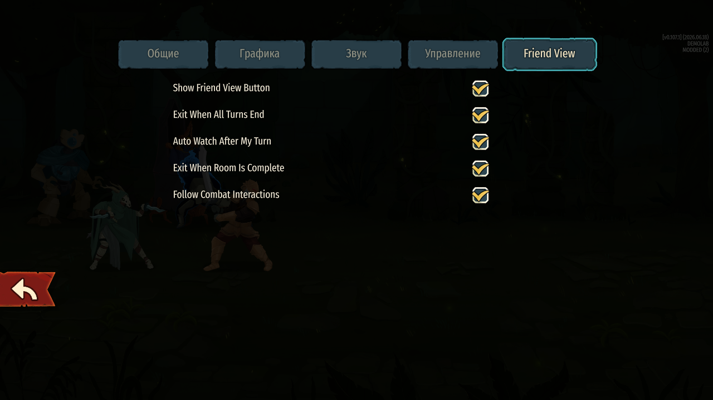
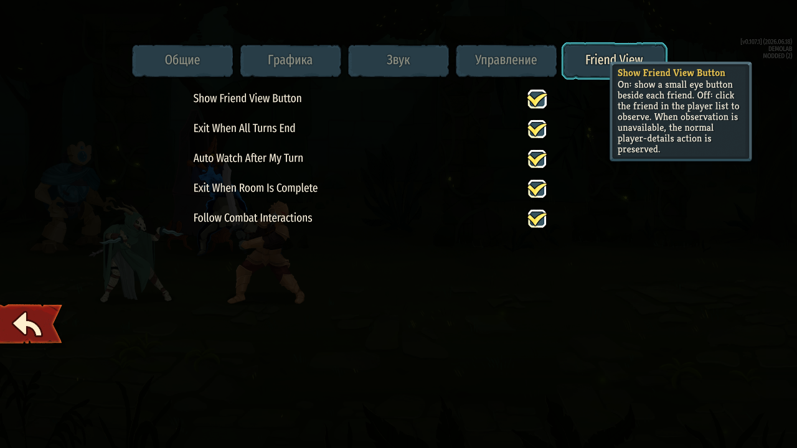
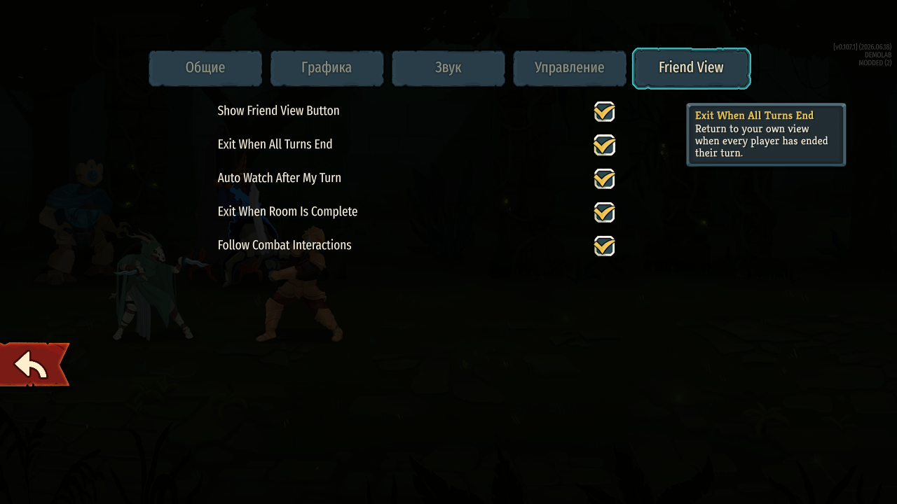
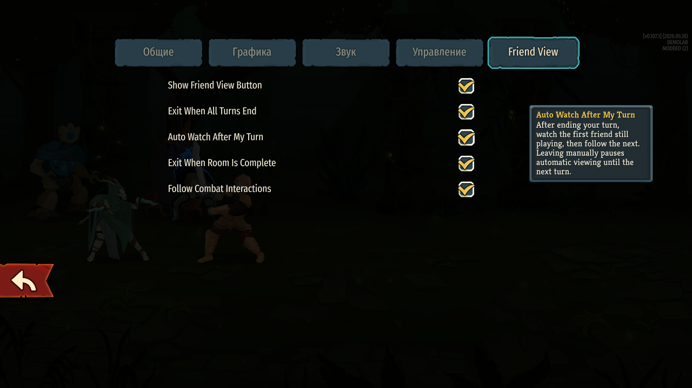
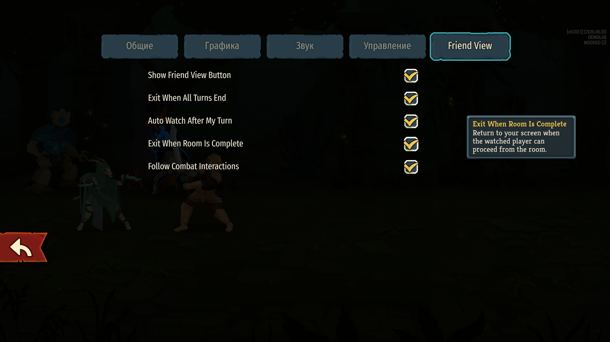
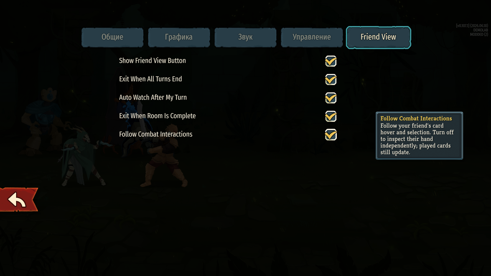

# Friend View settings

Finished your turn and wondering what your friend is planning? Friend View lets you watch their side of a Slay the Spire 2 co-op run: the cards in their hand, the rewards they are choosing, their shop, events and rest sites. See their health, relics, potions and character abilities while you talk through the next move, then return to your own screen whenever you like. You can both watch each other, too; each view shows the other player's own game.

Click the eye beside a friend to start watching. Click it again, click the watched friend's avatar, or press Esc / controller Cancel to return. If you open a deck or pile, Back closes that window first. Opening settings keeps your view in place.

Open **Settings → Friend View**. All five options default to **On** for a new installation. Existing saved choices are preserved. The mod includes English and Russian labels and native tooltips.

## Show Friend View Button

On: a small eye button appears beside each friend in the player list. Click it to watch them. Off: click their avatar instead. If viewing is unavailable, the avatar opens the usual player details.

## Exit When All Turns End

On: return to your own screen when everyone has finished their turn. Off: keep watching through the enemy turn, unless another exit condition applies.

## Auto Watch After My Turn

On: after you end your turn, start watching the first friend who is still playing. When they finish, move on to the next unfinished player. Leaving Friend View yourself pauses automatic watching until your next turn. Off: choose who to watch manually.

## Exit When Room Is Complete

On: return to your own screen as soon as the watched friend can press Continue to leave the room. Off: keep watching until you leave the view or the game changes to a screen that cannot be watched.

## Follow Combat Interactions

On: see which cards your friend hovers over, selects and aims at a target. Off: hover over and select their cards yourself to read them, without changing what your friend is doing. You still see cards being played, but cannot play their cards or use their potions.

## Availability

Everyone in the lobby needs the same game and Friend View version. Subscribe and enable the mod in the game's built-in mod menu; avoid installing a second manual copy. Tested with game v0.107.1. Treasure rooms and unsupported screens temporarily disable viewing. The map remains your shared map. The decorative merchant hand is hidden while watching.

Own code: MIT. Developed with OpenAI Codex, using Universal Modder, ILSpy and Harmony. Game art belongs to Mega Crit; the mod loads it from your installation. Workshop screenshots captured in game.
